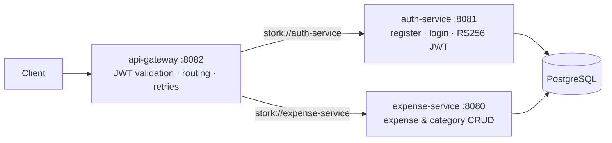

# Expense Tracker

A microservices backend for tracking personal expenses, built with **Quarkus**. Users register and log in, then
create, read, update and delete their own expenses and categories through a single API Gateway secured with JWT.

The backend was originally written with Spring Boot and Spring Cloud (Eureka, Spring Cloud Gateway) and has been
migrated to Quarkus. The Spring Boot version is still available in the git history.

## Architecture



| Service | Responsibility |
|---|---|
| **api-gateway** | Single entry point. Validates JWTs and routes requests through SmallRye Stork service discovery, with timeouts and retries. |
| **auth-service** | User registration, BCrypt password hashing, RS256-signed JWTs, public key published as a JWKS. |
| **expense-service** | Expense and category CRUD on PostgreSQL, with request validation. Verifies JWTs on its own. |

## Tech stack

Java 17 · Quarkus 3.40 (JAX-RS, CDI, Hibernate ORM with Panache, Hibernate Validator, SmallRye JWT, MicroProfile
REST Client, SmallRye Stork, MicroProfile Fault Tolerance, SmallRye OpenAPI) · PostgreSQL · Docker Compose ·
JUnit 5, RestAssured, WireMock · Postman

## Quick start

Requires Docker and `openssl`.

```bash
cd expense-tracker-quarkus
./scripts/generate-keys.sh     # RSA key pair for signing JWTs (git-ignored)
cp .env.example .env           # then set database passwords
docker compose up --build
```

The API is served at `http://localhost:8082`. Swagger UI is at `http://localhost:8082/q/swagger-ui`.

```bash
./scripts/smoke-test.sh        # end-to-end checks through the gateway
```

## Project structure

```
expense-tracker/
├── expense-tracker-quarkus/
│   ├── api-gateway/
│   ├── auth-service/
│   ├── expense-service/
│   ├── docker-compose.yml
│   ├── postman/              # importable Postman collection
│   ├── scripts/              # key generation, smoke test
│   └── README.md             # full documentation
└── frontend/                 # reserved for the frontend (not yet implemented)
```

## Documentation

The full documentation is in [`expense-tracker-quarkus/README.md`](expense-tracker-quarkus/README.md). It covers
the API endpoints, the JWT flow, service discovery, configuration, tests and notes on the Spring Boot → Quarkus
migration.

## Author

Aravind Yarramsetty · GitHub: https://github.com/aravind19062
