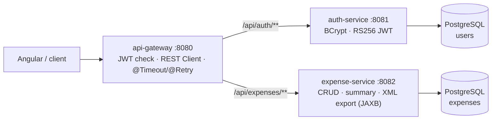

# Expense Tracker

A microservices backend for tracking personal expenses, built with **Quarkus** from an API spec. Users register
and log in, then manage their expenses through a single API gateway secured with JWT: CRUD with validation,
paging and filtering, a per-category summary, and an XML export that maps the JSON to a legacy accounting format.

**Migrated from Spring Boot.** The backend was first written with Spring Boot and Spring Cloud (Eureka, Spring
Cloud Gateway) and has been rebuilt in Quarkus. The Spring Boot version is in the git history.

## Architecture



## API

| Method | Path | Request | Success | Errors |
|---|---|---|---|---|
| POST | `/api/auth/register` | `{username, email, password}` | `201` | `400`, `409` |
| POST | `/api/auth/login` | `{username, password}` | `200` `{token, expiresIn}` | `400`, `401` |
| POST | `/api/expenses` | `{title, amount, category, expenseDate}` | `201` + created expense | `400` |
| GET | `/api/expenses?page=0&size=10&category=FOOD` | – | `200` + list | `400` |
| GET | `/api/expenses/{id}` | – | `200` | `404` |
| PUT | `/api/expenses/{id}` | full body | `200` | `400`, `404` |
| DELETE | `/api/expenses/{id}` | – | `204` | `404` |
| GET | `/api/expenses/summary` | – | `200` `{category: total}` | – |
| GET | `/api/expenses/export/xml` | – | `200` XML | – |

Expense routes need `Authorization: Bearer <jwt>` (`401` without it). Errors always look like
`{"code": "EXPENSE_NOT_FOUND", "message": "...", "timestamp": "..."}`.

## Tech stack

Java 17 · Quarkus 3.40 LTS (REST Jackson/JAXB, Hibernate ORM Panache, Hibernate Validator, SmallRye JWT,
MicroProfile REST Client, SmallRye Fault Tolerance, SmallRye Stork, SmallRye Health, Micrometer Prometheus,
SmallRye OpenAPI, Kubernetes) · PostgreSQL · Docker Compose · GitHub Actions · JUnit 5, RestAssured, WireMock ·
Postman

## Quick start

Requires Docker and `openssl`.

```bash
cd expense-tracker-quarkus
./scripts/generate-keys.sh     # RSA key pair for signing JWTs (git-ignored)
cp .env.example .env           # then set database passwords
docker compose up --build -d --wait
./scripts/smoke-test.sh        # end-to-end checks through the gateway
```

API: `http://localhost:8080` · Swagger UI: `http://localhost:8080/q/swagger-ui` · metrics: `/q/metrics` ·
health: `/q/health`

## Project structure

```
expense-tracker/
├── .github/workflows/build.yml   # mvn verify for each service
├── expense-tracker-quarkus/
│   ├── api-gateway/
│   ├── auth-service/
│   ├── expense-service/          # incl. ExpenseMapper (JSON → legacy XML)
│   ├── docker-compose.yml
│   ├── postman/
│   ├── scripts/                  # key generation, smoke test
│   └── README.md                 # full documentation
└── frontend/                     # reserved for the Angular app (not yet implemented)
```

## Documentation

See [`expense-tracker-quarkus/README.md`](expense-tracker-quarkus/README.md): the full API and validation rules,
the error codes, the XML mapping rules, the JWT flow, the gateway's fault tolerance, Docker, Kubernetes, tests and
CI, and the Spring Boot → Quarkus migration notes.

## Author

Aravind Yarramsetty · GitHub: https://github.com/aravind19062
