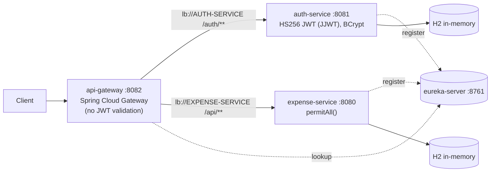
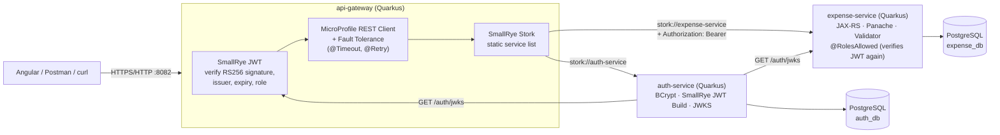
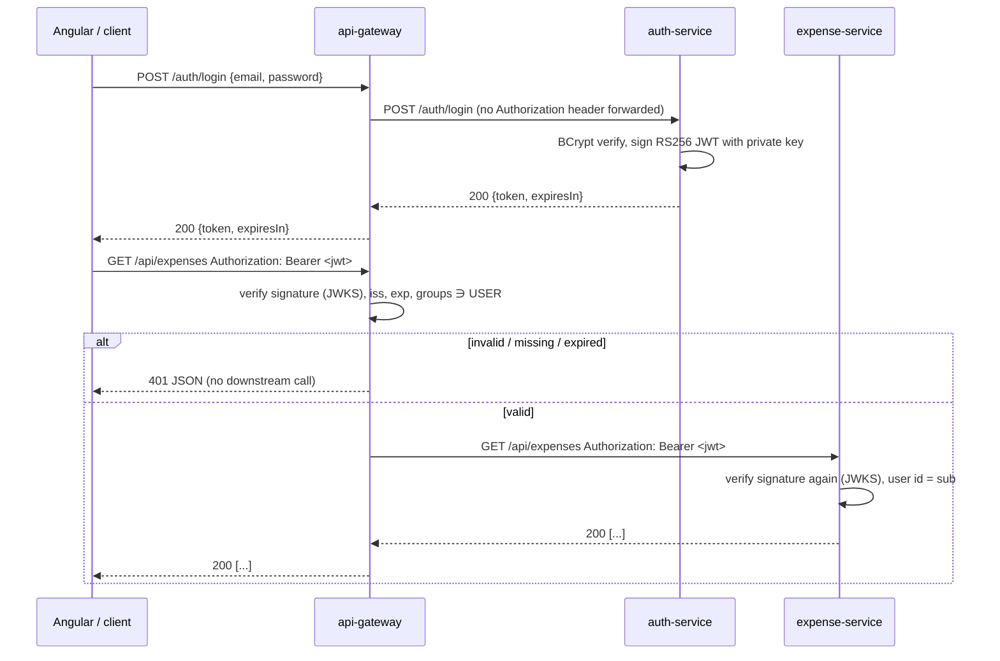

# Expense Tracker – Quarkus Microservices

The Expense Tracker backend, migrated from **Spring Boot 3.1 / Spring Cloud (Eureka + Spring Cloud Gateway)** to
**Quarkus 3.40 (LTS)**. The original Spring Boot code under [`../backend`](../backend) is untouched and kept as the
reference implementation.

| Component | What it is | Port |
|---|---|---|
| **api-gateway** | Quarkus service: single entry point, JWT validation, routing, timeouts/retries, CORS | `8082` (public) |
| **auth-service** | Quarkus service: registration, login, BCrypt hashing, RS256 JWT issuing, JWKS | `8081` (localhost only) |
| **expense-service** | Quarkus service: expense + category CRUD, PostgreSQL, independent JWT verification | `8080` (localhost only) |
| **Service discovery** | SmallRye Stork (static service list) **inside the gateway** – not a separate process | – |
| **PostgreSQL 18** | One server, one database per service (`auth_db`, `expense_db`) | `5432` (localhost only) |

> There are three Quarkus services. SmallRye Stork provides service discovery as a client-side library in the
> gateway, so there is no fourth discovery server. Stork replaces the Eureka server of the original.

---

## Contents

1. [Original Spring Boot architecture](#1-original-spring-boot-architecture)
2. [New Quarkus architecture](#2-new-quarkus-architecture)
3. [Service responsibilities](#3-service-responsibilities)
4. [Technology stack](#4-technology-stack)
5. [API endpoints](#5-api-endpoints)
6. [Authentication and JWT flow](#6-authentication-and-jwt-flow)
7. [Service discovery (SmallRye Stork)](#7-service-discovery-smallrye-stork)
8. [Gateway routing and fault tolerance](#8-gateway-routing-and-fault-tolerance)
9. [PostgreSQL configuration](#9-postgresql-configuration)
10. [Running with Docker](#10-running-with-docker)
11. [Local development (without containers for the services)](#11-local-development)
12. [Automated tests](#12-automated-tests)
13. [Postman collection](#13-postman-collection)
14. [Angular frontend](#14-angular-frontend)
15. [Migration from Spring Boot to Quarkus](#migration-from-spring-boot-to-quarkus)

---

## 1. Original Spring Boot architecture



- Four Spring Boot 3.1.9 modules: `expense-service`, `auth-service`, `api-gateway`, `eureka-server`.
- Data lived in **in-memory H2** databases (lost on restart).
- JWTs were **HS256 with a shared secret committed in `application.properties`**. The gateway declared the
  secret but never validated tokens, and expense-service allowed all requests (`permitAll()`).
- Expense endpoints: list, get-by-id and create only (the service had an unused update method, no delete).

## 2. New Quarkus architecture



## 3. Service responsibilities

**api-gateway**
- The only service the frontend talks to.
- Validates the JWT on every `/api/**` request. Invalid requests get a 401 and never reach a backend.
- Routes to the other services through Stork.
- Forwards only `Authorization` (to expense-service), `Content-Type` and the body. Cookies and any other client
  headers are dropped.
- Rewrites downstream `Location` headers so they point at the gateway.
- Applies timeouts and retries, and returns consistent JSON errors (401/403/503/504).
- Handles CORS.

**auth-service**
- Owns the `users` table.
- Registration with BCrypt hashing.
- Login, which issues RS256-signed JWTs.
- Role storage (`USER`, `ADMIN`).
- Publishes the public verification key as a JWKS at `GET /auth/jwks`.

**expense-service**
- Owns the `expense` and `category` tables.
- CRUD with validation and centralized error handling.
- Verifies the JWT signature on its own (it does not trust the gateway) and scopes every expense to the token's
  subject (user id).

## 4. Technology stack

| Concern | Technology |
|---|---|
| Runtime | Java 17, Quarkus 3.40.1.2 (LTS), Maven 3.9 |
| REST | Jakarta REST (JAX-RS) via `quarkus-rest-jackson` |
| DI | CDI (ArC) |
| Persistence | Hibernate ORM with Panache (repository pattern), PostgreSQL JDBC |
| Validation | Hibernate Validator (Jakarta Bean Validation) |
| Security | SmallRye JWT (verification), SmallRye JWT Build (issuing), Elytron `BcryptUtil` |
| Inter-service | MicroProfile REST Client, SmallRye Stork (static list), MicroProfile Fault Tolerance |
| API docs | SmallRye OpenAPI + Swagger UI |
| Health | SmallRye Health (`/q/health/ready`, used by Docker health checks) |
| Tests | JUnit 5, `@QuarkusTest`, RestAssured, Quarkus Dev Services (PostgreSQL via Testcontainers), WireMock 3.13 |
| Infra | Docker, Docker Compose, PostgreSQL 18 |

## 5. API endpoints

All paths are the same at the gateway and at the downstream service.

### Auth (public)

| Method | Path | Body | Success | Errors |
|---|---|---|---|---|
| POST | `/auth/register` | `{"userName","email","password"}` | `201` text `User registered successfully` | `400` validation / `User already exists` |
| POST | `/auth/login` | `{"email","password"}` | `200` `{"token","expiresIn"}` | `400` validation, `401` `invalid credentials` |
| GET | `/auth/jwks` (auth-service only) | – | `200` JSON Web Key Set (public key) | – |

### Expenses (Bearer JWT with role `USER`)

| Method | Path | Body | Success | Errors |
|---|---|---|---|---|
| GET | `/api/expenses` | – | `200` list of the caller's expenses | `401` |
| GET | `/api/expenses/{id}` | – | `200` expense | `404`, `401` |
| POST | `/api/expenses` | `{"title","amount","categoryId"?}` | `201` + `Location` | `400`, `404` (unknown category), `401` |
| PUT | `/api/expenses/{id}` | same as POST | `200` updated expense | `400`, `404`, `401` |
| DELETE | `/api/expenses/{id}` | – | `204` | `404`, `401` |

Expense response: `{"id":7,"title":"Weekly groceries","amount":82.45,"categoryId":3,"categoryName":"Groceries"}`

Validation: `title` is required and at most 100 characters. `amount` is required, must be greater than 0 (the
original business rule), and can have at most 8 integer digits and 2 decimals.

### Categories (Bearer JWT with role `USER`)

| Method | Path | Body | Success | Errors |
|---|---|---|---|---|
| GET | `/api/categories` | – | `200` list | `401` |
| GET | `/api/categories/{id}` | – | `200` | `404` |
| POST | `/api/categories` | `{"categoryName"}` | `201` + `Location` | `400` |
| PUT | `/api/categories/{id}` | `{"categoryName"}` | `200` | `400`, `404` |
| DELETE | `/api/categories/{id}` | – | `204` | `404`, `409` category still used by expenses |

Category response keeps the original property name: `{"category_id":3,"categoryName":"Groceries"}`

### Error format (all services)

```json
{
  "timestamp": "2026-11-19T14:29:32.696Z",
  "status": 400,
  "error": "Bad Request",
  "message": "Validation failed",
  "path": "/api/expenses",
  "violations": [{ "field": "amount", "message": "Expense amount must be greater than zero" }]
}
```

### API contract changes vs. the Spring Boot version

| Change | Reason |
|---|---|
| `PUT` and `DELETE /api/expenses/{id}` added | Full CRUD was a requirement. The update logic already existed in the Spring service but had no endpoint. |
| Expense JSON now contains `categoryId` / `categoryName`. Requests send `categoryId`. | In the original, `@JsonBackReference` hid `category` in both directions, so an expense's category could neither be set nor read through the API. |
| Category JSON no longer embeds the nested `expenses` list | It came from the bidirectional JPA mapping (`@JsonManagedReference`) and would expose other users' expenses. |
| All `/api/**` endpoints require a JWT with role `USER`. Users only see their own expenses. | The original had no authorization (`permitAll()`). |
| Error bodies are JSON (see above) instead of plain strings | One consistent error format across services. |
| Missing resources return 404. Other failures return their correct status (400/409/500). | The original handler mapped every `RuntimeException` to 404. |
| Bad credentials → 401, duplicate email → 400 (as the original handlers intended) | The original service threw plain `RuntimeException`s, so these handlers never fired. |
| Deleting a category that is still used returns 409 | The original cascaded the delete to all its expenses, which with per-user data would delete other users' expenses. |
| Login response adds `expiresIn` (seconds). `token` is unchanged. | Additive. |
| Registration validates input (valid email, password 6–72 characters) and treats email as case-insensitive | The original had no validation. 72 bytes is BCrypt's input limit. |
| `POST /auth/register` still returns `text/plain` | Unchanged from the original contract. |

OpenAPI and Swagger UI are served by every service at `/q/openapi` and `/q/swagger-ui`, for example
http://localhost:8082/q/swagger-ui.

## 6. Authentication and JWT flow



**Token claims** (real example from the running stack):

```json
{ "iss": "https://expense-tracker.local/auth", "sub": "6",
  "upn": "verify@example.com", "email": "verify@example.com", "preferred_username": "Verify",
  "groups": ["USER"], "iat": 1795098560, "exp": 1795102160, "jti": "ddf40bcc-..." }
```

The header is `{"kid":"<SHA-256 JWK thumbprint>","typ":"JWT","alg":"RS256"}`.

- `sub` is the user id, which expense-service uses as the expense owner.
- `groups` holds the roles. `ADMIN` users get `["ADMIN","USER"]`. Self-registration always creates `USER`, and
  `ADMIN` can only be assigned in the database.
- Tokens live for 1 hour (as in the original). This is configurable with `JWT_LIFESPAN_SECONDS`.

**Key management**
- `scripts/generate-keys.sh` creates a 2048-bit RSA key pair in `keys/`, which is git-ignored (as is every
  `*.pem`).
- In Docker the private key is mounted into auth-service only, as a Compose secret
  (`/run/secrets/jwt_private_key`). auth-service derives the public key from it and publishes it at
  `GET /auth/jwks`.
- api-gateway and expense-service fetch the JWKS (`mp.jwt.verify.publickey.location`) and refresh it every 10
  minutes.
- Tests generate throwaway key pairs at run time, so no key material of any kind is committed.

## 7. Service discovery (SmallRye Stork)

The gateway's REST clients use logical service names instead of URLs:

```properties
quarkus.rest-client.auth-service.url=stork://auth-service
quarkus.rest-client.expense-service.url=stork://expense-service

quarkus.stork.auth-service.service-discovery.type=static
quarkus.stork.auth-service.service-discovery.address-list=${AUTH_SERVICE_ADDRESSES:localhost:8081}
quarkus.stork.expense-service.service-discovery.type=static
quarkus.stork.expense-service.service-discovery.address-list=${EXPENSE_SERVICE_ADDRESSES:localhost:8080}
```

On each call, Stork resolves `stork://expense-service` to one of the addresses in the list (round-robin when
there are several, e.g. `EXPENSE_SERVICE_ADDRESSES=expense-1:8080,expense-2:8080`).

| Where | `AUTH_SERVICE_ADDRESSES` | `EXPENSE_SERVICE_ADDRESSES` |
|---|---|---|
| Local dev (default) | `localhost:8081` | `localhost:8080` |
| docker-compose | `auth-service:8081` (Docker DNS) | `expense-service:8080` |
| Gateway tests | WireMock port | WireMock port (or a closed port) |

Because the gateway tests register their WireMock servers in the same Stork lists, the discovery path is
exercised by the automated tests. Switching to Consul or Kubernetes later only means changing
`service-discovery.type`; the REST clients stay the same.

## 8. Gateway routing and fault tolerance

| Gateway route | Auth | Downstream (via Stork) | Timeout | Retry |
|---|---|---|---|---|
| `POST /auth/register` | public | `auth-service` `POST /auth/register` | 5 s | never (not idempotent) |
| `POST /auth/login` | public | `auth-service` `POST /auth/login` | 5 s | never (auth failures are not retried) |
| `GET /api/expenses[/{id}]`, `GET /api/categories[/{id}]` | JWT `USER` | `expense-service` same path | 3 s | 2 retries |
| `POST /api/expenses`, `POST /api/categories` | JWT `USER` | same path | 5 s | never (a retry could create duplicates) |
| `PUT`, `DELETE` on `/{id}` | JWT `USER` | same path | 5 s | 2 retries (idempotent) |

Retry rules:
- A retry happens only on transport failures (`ProcessingException`: connection refused/reset, unknown host)
  or a `@Timeout`. The delay is 200 ms ± 100 ms of jitter.
- HTTP error responses (400/401/403/404/409/5xx) come back as responses and are relayed unchanged, because the
  default REST-client exception mapper is disabled. They are never retried.
- The connect timeout is 1 s (`DOWNSTREAM_CONNECT_TIMEOUT_MS`).
- One caveat for `DELETE`: if the first attempt deleted the row but its response was lost, the retry returns
  404.

Gateway-generated errors:

| Situation | Status |
|---|---|
| Missing, invalid or expired JWT | `401` + `WWW-Authenticate: Bearer` |
| Wrong role | `403` |
| Downstream unreachable | `503` |
| Downstream too slow | `504` |

CORS allows `CORS_ORIGINS` (default `http://localhost:4200`) with methods `GET, POST, PUT, DELETE, OPTIONS`,
headers `Authorization, Content-Type, Accept`, and exposes `Location`.

## 9. PostgreSQL configuration

- One PostgreSQL 18 server. `docker/postgres/init-databases.sh` creates `auth_db` (owner `auth_user`) and
  `expense_db` (owner `expense_user`), and revokes `PUBLIC` access. Each service can only connect to its own
  database (verified: `expense_user` → `auth_db` is refused).
- Data is stored in the named volume `pgdata`, so it survives `docker compose down` and restarts (verified).
  `docker compose down -v` deletes it.
- Schemas are created by Hibernate, using the same approach as the original (`ddl-auto=update`).

| Profile | Datasource | Schema strategy |
|---|---|---|
| `%dev` (`mvn quarkus:dev`) | `DB_URL` (default `jdbc:postgresql://localhost:5432/<db>`), `DB_USERNAME` (default `<svc>_user`), `DB_PASSWORD` (required, no default) | `update` |
| `%test` | Quarkus Dev Services starts a throwaway `postgres:18` container | `drop-and-create` |
| `%prod` (Docker) | `DB_URL`, `DB_USERNAME`, `DB_PASSWORD`, all required from the environment | `update` |

No passwords or keys appear in any `application.properties`.

## 10. Running with Docker

Prerequisites: Docker with Compose v2 and `openssl`.

```bash
cd expense-tracker-quarkus
./scripts/generate-keys.sh          # RSA key pair -> ./keys (git-ignored)
cp .env.example .env                # then set real passwords in .env (git-ignored)
docker compose up --build           # add -d --wait to run in the background until healthy
./scripts/smoke-test.sh             # 21 end-to-end checks through the gateway
```

Startup order is enforced with health checks: `postgres` (both DBs exist) → `auth-service` (ready) →
`expense-service` (ready) → `api-gateway` (ready).

| Port | Service | Bound to |
|---|---|---|
| 8082 | api-gateway (use this) | all interfaces |
| 8081 | auth-service | 127.0.0.1 (debugging / Postman "direct" folder) |
| 8080 | expense-service | 127.0.0.1 |
| 5432 | PostgreSQL | 127.0.0.1 (for local dev mode) |

Images are multi-stage builds: Maven + JDK 17 build the app, and the runtime is `eclipse-temurin:17-jre`
running as a non-root user. Tests are not run inside `docker build`, because they need Docker themselves; run
them with Maven (see §12).

## 11. Local development

Run PostgreSQL in Docker and the services in Quarkus dev mode (live reload). This setup was verified with all
three services and the smoke test.

```bash
./scripts/generate-keys.sh
docker compose up -d postgres
set -a; . ./.env; set +a

(cd auth-service    && DB_PASSWORD=$AUTH_DB_PASSWORD    ./mvnw quarkus:dev)   # :8081, key from ../keys
(cd expense-service && DB_PASSWORD=$EXPENSE_DB_PASSWORD ./mvnw quarkus:dev)   # :8080
(cd api-gateway     && ./mvnw quarkus:dev)                                    # :8082
```

Stop the Compose app containers first (`docker compose stop api-gateway expense-service auth-service`) or the
ports will clash.

## 12. Automated tests

```bash
(cd expense-service && ./mvnw test)   # 37 tests
(cd auth-service    && ./mvnw test)   # 16 tests
(cd api-gateway     && ./mvnw test)   # 19 tests
```

Docker must be running: expense-service and auth-service tests use a real PostgreSQL started by Dev Services.
No service needs to be started by hand.

| Service | What is covered |
|---|---|
| expense-service | Create (201 + `Location` + body), list (only the caller's, ordered), get by id, update, delete (204 then 404). Validation: negative/zero/missing amount, blank/too-long title, malformed JSON, invalid update leaves data unchanged. 404s: unknown id, unknown category, another user's expense (read/update/delete). Security: no JWT, valid JWT, untrusted signing key, tampered payload, expired, wrong issuer, garbage, missing role (403). Category CRUD incl. 409 on delete in use. OpenAPI document, Swagger UI, health. |
| auth-service | Registration (201 + original message, email normalisation, `USER` role). Salted BCrypt hash in DB (`$2a$10$…`, differs per user, verifies). Duplicate email (case-insensitive). Field validation. Role cannot be self-assigned. Login success, wrong password and unknown email (same 401). Missing fields. Token verified against the service's own JWKS: RS256 header + `kid`, all claims. `exp - iat = 3600` and token rejected after expiry. ADMIN groups. Tampered token fails. JWKS contains no private parts. Startup fails fast on missing or garbage key. |
| api-gateway | Public register/login relayed. Authorization/Cookie not forwarded to auth-service. 401 from login relayed and not retried. Protected route without JWT / with forged, expired or garbage JWT → 401, with zero downstream calls. Valid JWT forwarded with only the bearer header. `Location` rewritten. Downstream 400/404 relayed unchanged and not retried. GET retried after connection reset then succeeds. Slow GET → 3 attempts → 504. Slow POST → 1 attempt → 504. POST connection failure → 1 attempt → 503. Persistent failure → 3 attempts → 503. Unreachable service (closed port) → 503. CORS preflight allowed/denied. |

## 13. Postman collection

Import `postman/expense-tracker.postman_collection.json` (Postman → Import), start the stack, and run the
collection top to bottom with the Collection Runner. It can also be run from the command line:

```bash
npx newman run postman/expense-tracker.postman_collection.json
```

Verified result: 20 requests, 38 assertions, 0 failures.

Folders:
- **Auth Service** (register, duplicate, invalid, wrong password, login). The login request saves the JWT into
  the `token` collection variable.
- **Categories**
- **Expense Service** (create, list, get, update, 400, 409, delete, 404)
- **Security checks** (no JWT, invalid JWT)
- **Expense Service (direct)**: calls :8080 with a valid token and with a token whose payload was forged, to show
  that the service verifies signatures itself.

Each request has test scripts, and the key requests include saved example responses. The email is randomised on
each run, so the collection can be run repeatedly.

## 14. Angular frontend

**There is no Angular application in this repository.** The original `frontend/` folder contains only
`.gitkeep`, and git history shows it never contained anything else. Nothing was therefore changed or integrated
on the frontend side.

The backend is ready for an Angular client:
- the gateway is the single entry point on `http://localhost:8082`
- CORS for `http://localhost:4200` is configured and covered by tests
- the `Location` header is exposed to browsers

When an Angular app is added, put the base URL in its environment configuration and send the token from
`/auth/login` as a Bearer header, for example `environment.ts` →
`export const environment = { apiBaseUrl: 'http://localhost:8082' };` plus an HTTP interceptor. This is guidance
only and was **not** implemented or tested here.

---

## Migration from Spring Boot to Quarkus

### Why

- **Startup time and memory.** Quarkus does most framework work (CDI wiring, annotation scanning, Hibernate
  metadata) at build time. In the Docker setup here the services report "started in" 1.6–4.2 s on the JVM (gateway fastest),
  including connecting to PostgreSQL and the schema update. That suits containerised, independently restarted
  microservices. (No side-by-side benchmark against the Spring version was run.)
- **Standard APIs.** JAX-RS, CDI, Jakarta Persistence, Bean Validation and MicroProfile (JWT, REST Client,
  Fault Tolerance, OpenAPI, Health) replace Spring-specific equivalents.
- **Less infrastructure.** The Eureka server and Spring Cloud Gateway are replaced by a small Quarkus gateway
  with Stork, so there is one fewer service to run.
- **Fixing the security model.** The migration was the point at which shared HS256 secrets were replaced with
  RS256 + JWKS and authorization was actually enforced.

### Major framework differences

| Spring Boot (original) | Quarkus (new) |
|---|---|
| `@RestController`, `@RequestMapping`, `@GetMapping`… | `@Path`, `@GET`/`@POST`/`@PUT`/`@DELETE`, `@Produces/@Consumes(APPLICATION_JSON)` |
| `@PathVariable`, `@RequestBody`, `ResponseEntity` | `@PathParam`, plain parameter, `Response` / return value |
| `@Service`, `@Component`, `@Autowired` | `@ApplicationScoped`, constructor injection / `@Inject` |
| `JpaRepository<T, ID>` | `PanacheRepository<T>` (`listAll`, `findByIdOptional`, `persist`, `find(...)`) |
| `org.springframework.transaction.annotation.Transactional` | `jakarta.transaction.Transactional` |
| `@RestControllerAdvice` + `@ExceptionHandler` | `@ServerExceptionMapper` methods (Quarkus REST) |
| Spring Security `SecurityFilterChain` | `@RolesAllowed` / `@PermitAll` + SmallRye JWT |
| JJWT HS256 + shared secret | SmallRye JWT Build (RS256 sign) / SmallRye JWT (verify via JWKS) |
| Spring `BCryptPasswordEncoder` | Elytron `BcryptUtil.bcryptHash / matches` (same `$2a$` format) |
| Eureka server + `lb://SERVICE` | SmallRye Stork `stork://service` with a static list |
| Spring Cloud Gateway route config | JAX-RS routes + MicroProfile REST Client + Fault Tolerance |
| `application.properties` with Spring profiles | `application.properties` with `%dev/%test/%prod` prefixes and `${ENV:default}` |
| H2 in-memory | PostgreSQL (Dev Services in tests) |
| `@SpringBootTest` + MockMvc, Mockito | `@QuarkusTest` + RestAssured against a real HTTP port and real PostgreSQL |

### Controller → JAX-RS

`ExpenseController` became `ExpenseResource`. The Spring request-mapping annotations map one-to-one to JAX-RS
annotations. The `if (amount <= 0) throw IllegalArgumentException` check in the controller became a declarative
`@DecimalMin(value="0", inclusive=false)` on a request record validated with `@Valid`. The service keeps the
original guard as a second line of defence. `201 Created` is built with
`Response.created(uriInfo...path(id))`, so a `Location` header is now included.

### Dependency injection

Field injection with `@Autowired` (the original combined it with constructor injection on `final` fields)
became constructor injection in services and `@Inject` in resources. Beans are `@ApplicationScoped`. CDI
resolves the graph at build time, so a missing bean fails the build rather than startup.

### Repository → Panache

`ExpenseRepository extends JpaRepository` became `ExpenseRepository implements PanacheRepository<Expense>`.
Derived query methods such as `findByEmail` became explicit Panache queries (`find("email", email)`). New
owner-scoped queries use `left join fetch` to avoid N+1 selects when mapping category names. The entities keep
the original tables and columns. Spring Boot's default naming strategy produces snake_case (`user_name`,
`category_name`), while Hibernate in Quarkus uses field names as-is, so the column names are now written
explicitly with `@Column(name = ...)` to keep the same schema.

### Transactions

`@Transactional` moved to `jakarta.transaction.Transactional` on the write methods of the services. Updates
rely on dirty checking of managed entities, so no explicit `save()` is needed. Reads run without a transaction.
The original `addExpense` was transactional but `updateExpenseById` was not; now every write is.

### Exception handling

The single `@RestControllerAdvice` that turned every `RuntimeException` into 404 was replaced by
`@ServerExceptionMapper`s:

| Exception | Status |
|---|---|
| `ResourceNotFoundException` | 404 |
| `ConflictException` | 409 |
| `IllegalArgumentException` | 400 |
| `ConstraintViolationException` | 400 with a per-field list |
| `WebApplicationException`, e.g. malformed JSON | keeps its status |
| `UserAlreadyExistsException` | 400 |
| `WrongCredException` | 401 |

All produce the same JSON body. The gateway adds mappers for authentication (401/403), unreachable services
(503) and timeouts (504).

### Configuration

- Spring profiles became Quarkus profile prefixes (`%dev.`, `%test.`, `%prod.`).
- Every secret is an environment variable with no default: `DB_PASSWORD`, `JWT_PRIVATE_KEY_LOCATION`,
  `POSTGRES_PASSWORD`, and so on.
- Eureka properties became `quarkus.stork.*`, and Spring Cloud Gateway routes became REST clients.
- The committed `jwt.secret` is gone entirely.

### JWT implementation

The original HS256 tokens were signed with one shared secret, so every service that verifies tokens could also
mint them. The new design uses asymmetric keys:
- only auth-service holds the RSA private key
- verifiers fetch the public key from `/auth/jwks`
- `@RolesAllowed("USER")` enforces the `groups` claim
- the gateway and expense-service each verify signature, issuer and expiry independently

The subject changed from the email to the numeric user id, so ownership survives an email change. The email is
still available in `upn` and `email`.

### Problems in the original code found during the migration

These existed in the Spring Boot code and are fixed in the Quarkus version. The original is intentionally left
as is.

1. `@JsonBackReference` on `Expense.category` made categories impossible to assign or read through the expense
   API.
2. `AuthService` threw plain `RuntimeException`s, so the 400/401 handlers in `GlobalExceptionHandler` never
   fired. The controller tests passed only because they mocked the custom exceptions.
3. The expense service's catch-all handler turned every `RuntimeException`, including programming errors, into
   404.
4. The gateway declared `jwt.secret` but performed no JWT validation, and expense-service used `permitAll()`.
5. The HS256 signing secret is committed in plain text in `backend/auth-service` and `backend/api-gateway`
   `application.properties`, and therefore in git history. It should be treated as compromised and must not be
   reused.
6. `CascadeType.ALL` from `Category` to `Expense` meant deleting a category silently deleted its expenses.

### Challenges encountered during implementation

Only problems that actually occurred while building and verifying this project:

1. **Stork needed an explicit extension.**
   - Symptom: the first gateway test run failed at the first downstream call with
     `IllegalStateException: Trying to use a StorkClientRequestFilter but the quarkus-smallrye-stork extension
     is missing`.
   - Cause: in Quarkus 3.40, adding only the `stork-service-discovery-static-list` library is not enough; the
     REST client does not bring in the Stork extension.
   - Fix: add `io.quarkus:quarkus-smallrye-stork` to the gateway POM.

2. **Downstream error bodies were being replaced by the gateway.**
   - Symptom: a 401 from auth-service reached the client as 401, but its body read `"Unauthorized"` instead of
     `"invalid credentials"`, and the same happened to 400 validation details.
   - Cause: the MicroProfile REST Client's default `ResponseExceptionMapper` turns every 4xx/5xx into a
     `WebApplicationException`. I had disabled it with a global `quarkus.rest-client.disable-default-mapper`,
     which Quarkus 3.40 does not recognise. The startup log contained
     `Unrecognized configuration key ... will be ignored`.
   - Fix: inspecting the extension's config metadata showed the setting is per client:
     `quarkus.rest-client.<client>.disable-default-mapper=true`. Now downstream responses are relayed verbatim,
     and HTTP errors can never trigger a retry. The test logs of all services were then checked for further
     `Unrecognized configuration key` warnings; there are none.

3. **A stopped service produced a slow 504 instead of a 503.**
   - Symptom: WireMock and closed-port tests covered "connection refused", but in Docker, stopping
     expense-service made the gateway answer **504 after about 9.6 s**.
   - Cause: the connection attempts didn't fail fast. Each of the three attempts ran into the 3 s `@Timeout`
     (3 × 3 s + retry delays).
   - Fix: a 1 s REST-client `connect-timeout`. Re-tested in Docker, the gateway now returns **503 in about
     1.1 s** (the logged cause is `UnknownHostException`, because Docker removes a stopped container's DNS
     entry). After `docker compose start expense-service`, one request about a second later still got a 503;
     every request after that succeeded with no gateway restart.

