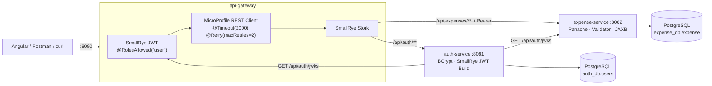
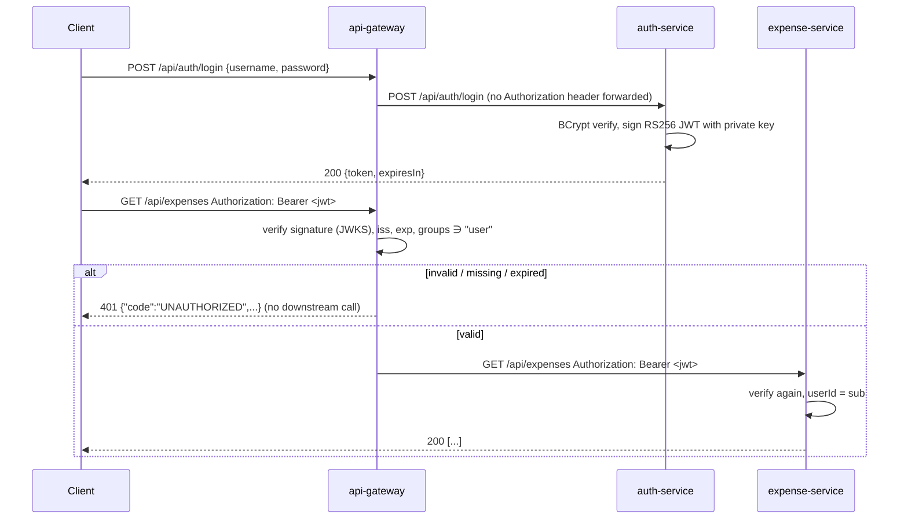

# Expense Tracker – Quarkus Microservices

Three Quarkus 3.40 (LTS) services built from an API spec: an **API gateway**, an **auth service** that issues JWTs,
and an **expense service** with CRUD, paging, a per-category summary and an **XML export that maps the JSON to a
legacy accounting format**.

> **Migrated from Spring Boot.** This backend was first written with Spring Boot 3.1 and Spring Cloud (Eureka,
> Spring Cloud Gateway, H2, HS256 JWTs) and was rebuilt in Quarkus. The Spring Boot code is in the git history
> (`git show 96ec8d1:backend`). See [Migrated from Spring Boot](#migrated-from-spring-boot).

```
Angular UI ──► Gateway (Quarkus, :8080)
                 │  checks JWT, forwards via REST Client
                 ├──► Auth service (:8081)     → users table (PostgreSQL)
                 └──► Expense service (:8082)  → expenses table (PostgreSQL)
                                │
                                └── /export/xml → JSON→XML mapping (JAXB)
```



| Service | Port | Responsibility | Extensions |
|---|---|---|---|
| **api-gateway** | 8080 (public) | Single entry point. Verifies the JWT, forwards `/api/**` through MicroProfile REST Client interfaces with timeouts and retries, CORS | REST Jackson, REST Client Jackson, SmallRye JWT, SmallRye Fault Tolerance, SmallRye Stork, Health, Micrometer Prometheus, OpenAPI, Kubernetes |
| **auth-service** | 8081 | Register (BCrypt), login (signed RS256 JWT, `upn` = username, `groups` = `["user"]`), JWKS | REST Jackson, Hibernate ORM Panache, JDBC PostgreSQL, Hibernate Validator, SmallRye JWT Build, Health, Micrometer Prometheus, OpenAPI, Kubernetes |
| **expense-service** | 8082 | Expense CRUD, paging and filtering, summary, XML export, validation, verifies the JWT again | REST Jackson, REST JAXB, Hibernate ORM Panache, JDBC PostgreSQL, Hibernate Validator, SmallRye JWT, Health, Micrometer Prometheus, OpenAPI, Kubernetes |

---

## Contents

1. [API](#1-api)
2. [Validation and error format](#2-validation-and-error-format)
3. [XML export and the ExpenseMapper](#3-xml-export-and-the-expensemapper)
4. [Authentication and JWT](#4-authentication-and-jwt)
5. [Gateway: routing, REST Client and fault tolerance](#5-gateway-routing-rest-client-and-fault-tolerance)
6. [Health, metrics and Swagger](#6-health-metrics-and-swagger)
7. [Running with Docker Compose](#7-running-with-docker-compose)
8. [Local development](#8-local-development)
9. [Kubernetes](#9-kubernetes)
10. [Tests and CI](#10-tests-and-ci)
11. [Postman collection](#11-postman-collection)
12. [Migrated from Spring Boot](#migrated-from-spring-boot)

---

## 1. API

All paths are the same at the gateway (`:8080`) and at the service behind it.

### Expense service: `/api/expenses` (Bearer JWT with group `user`)

Data model: `Expense { id, userId, title, amount, category, expenseDate, createdAt }`

| Method | Path | Request | Success | Errors |
|---|---|---|---|---|
| POST | `/api/expenses` | `{title, amount, category, expenseDate}` | `201` + created expense + `Location` | `400` validation |
| GET | `/api/expenses?page=0&size=10&category=FOOD` | – | `200` + list (newest first), header `X-Total-Count` | `400` bad page/size/category |
| GET | `/api/expenses/{id}` | – | `200` | `404` `EXPENSE_NOT_FOUND` |
| PUT | `/api/expenses/{id}` | full body | `200` | `400`, `404` |
| DELETE | `/api/expenses/{id}` | – | `204` | `404` |
| GET | `/api/expenses/summary` | – | `200` `{category: total}` | – |
| GET | `/api/expenses/export/xml` | – | `200` `application/xml` | – |

Every endpoint also returns `401` without a valid token and `403` if the token lacks the `user` group. Each user
only sees their own expenses (`userId` = the token's `sub`). Another user's expense is reported as `404`.

`page` defaults to 0 and `size` to 10 (1–100). `category` is optional.

```json
POST /api/expenses
{"title": "Weekly groceries", "amount": 82.40, "category": "FOOD", "expenseDate": "2026-11-03"}

201 Created   Location: http://localhost:8080/api/expenses/3
{"id":3,"userId":"4","title":"Weekly groceries","amount":82.4,"category":"FOOD",
 "expenseDate":"2026-11-03","createdAt":"2026-11-20T17:01:41.184229467Z"}

GET /api/expenses/summary
{"FOOD":82.40,"TRAVEL":0.00,"BILLS":64.30,"SHOPPING":0.00,"OTHER":0.00}
```

The summary always lists all five categories in a fixed order. Totals are computed in the database
(`select category, sum(amount) ... group by category`).

### Auth service: `/api/auth` (public)

| Method | Path | Request | Success | Errors |
|---|---|---|---|---|
| POST | `/api/auth/register` | `{username, email, password}` | `201` `{id, username, email}` | `400` validation, `409` `USER_ALREADY_EXISTS` |
| POST | `/api/auth/login` | `{username, password}` | `200` `{token, expiresIn}` | `400` validation, `401` `INVALID_CREDENTIALS` |
| GET | `/api/auth/jwks` (auth-service only) | – | `200` JSON Web Key Set (public key) | – |

Usernames are 3–50 characters (`A-Z a-z 0-9 . _ -`), stored in lower case and unique. Emails are unique and
case-insensitive. Passwords must be 6–72 characters (72 bytes is BCrypt's input limit).

## 2. Validation and error format

| Field | Rule | Message |
|---|---|---|
| `title` | required, not blank, ≤ 100 chars | `Title is required` |
| `amount` | required, `> 0`, ≤ 8 integer digits and 2 decimals | `Amount must be greater than zero` |
| `category` | one of `FOOD, TRAVEL, BILLS, SHOPPING, OTHER` (case-sensitive) | `Category must be one of FOOD, TRAVEL, BILLS, SHOPPING, OTHER` |
| `expenseDate` | required, `yyyy-MM-dd`, not in the future (`@PastOrPresent`, today is allowed) | `Expense date must not be in the future` |

`category` is received as a string and checked with `@Pattern`, so an unknown category gives a normal
validation error that lists the allowed values, not a JSON parse error.

**Error format (same in all three services):**

```json
{ "code": "EXPENSE_NOT_FOUND", "message": "Expense 424242 not found", "timestamp": "2026-11-20T17:01:41.380Z" }
```

Validation errors add a `details` array so a UI can highlight each field:

```json
{
  "code": "VALIDATION_FAILED",
  "message": "Validation failed: amount - Amount must be greater than zero; category - Category must be one of ...",
  "timestamp": "2026-11-20T17:01:41.344Z",
  "details": [
    { "field": "amount", "message": "Amount must be greater than zero" },
    { "field": "category", "message": "Category must be one of FOOD, TRAVEL, BILLS, SHOPPING, OTHER" },
    { "field": "expenseDate", "message": "Expense date must not be in the future" },
    { "field": "title", "message": "Title is required" }
  ]
}
```

| Code | Status | Where |
|---|---|---|
| `VALIDATION_FAILED` | 400 | expense, auth |
| `MALFORMED_REQUEST` | 400 | broken JSON or wrong type/format, e.g. `"expenseDate": "03-11-2026"` |
| `UNAUTHORIZED` | 401 | missing, invalid or expired JWT (gateway, expense) |
| `INVALID_CREDENTIALS` | 401 | auth login (unknown user and wrong password look identical) |
| `FORBIDDEN` | 403 | token without the `user` group |
| `EXPENSE_NOT_FOUND` | 404 | expense |
| `NOT_FOUND` | 404 | unknown path |
| `USER_ALREADY_EXISTS` | 409 | auth register |
| `INTERNAL_ERROR` | 500 | unexpected exception (logged, details not exposed) |
| `SERVICE_UNAVAILABLE` | 503 | gateway: downstream unreachable after retries |
| `GATEWAY_TIMEOUT` | 504 | gateway: downstream too slow after retries |

All of these are `@ServerExceptionMapper` methods in each service's `ExceptionMappers` class.

## 3. XML export and the ExpenseMapper

`GET /api/expenses/export/xml` reshapes the caller's expenses for an imaginary legacy accounting system.

| JSON field | XML element | Rule |
|---|---|---|
| `title` | `<Description>` | Uppercase (`Locale.ROOT`, so the result doesn't depend on the server locale) |
| `amount` | `<Amt>` | Exactly 2 decimal places (`HALF_UP`) |
| `category` | `<CatCode>` | `FOOD→F01`, `TRAVEL→T01`, `BILLS→B01`, `SHOPPING→S01`, `OTHER→O01` |
| `expenseDate` | `<TxnDate>` | `dd-MM-yyyy` |

Real output from the running stack:

```xml
<?xml version="1.0" encoding="UTF-8" standalone="yes"?>
<Expenses>
  <Expense>
    <Description>WEEKLY GROCERIES</Description>
    <Amt>82.40</Amt>
    <CatCode>F01</CatCode>
    <TxnDate>03-11-2026</TxnDate>
  </Expense>
  <Expense>
    <Description>ELECTRICITY BILL</Description>
    <Amt>64.30</Amt>
    <CatCode>B01</CatCode>
    <TxnDate>01-11-2026</TxnDate>
  </Expense>
</Expenses>
```

(Pretty-printed here; the service sends it on one line.)

How it is built:

```
Expense (entity) ──► ExpenseResponse (the JSON DTO) ──► ExpenseMapper ──► LegacyExpense / LegacyExpenseExport ──► JAXB (quarkus-rest-jaxb)
```

- `mapper/ExpenseMapper.java` holds every rule and nothing else. It has no framework dependencies, so it is
  unit-tested with plain JUnit.
- The category code is an exhaustive `switch` over the enum, so adding a category without a code is a compile
  error.
- `xml/LegacyExpense.java` and `xml/LegacyExpenseExport.java` are JAXB classes (`@XmlRootElement`,
  `@XmlElement(name = "Amt")`, `@XmlType(propOrder = ...)`) that only carry already-formatted strings.
- A null input field becomes a missing element, so one bad record can't break the whole export.
- `ExpenseMapperTest` has 29 tests: each rule with edge cases (`10 → 10.00`, `3.455 → 3.46`, `1E+3 → 1000.00`,
  `29-02-2024`, accented characters, every category), null handling, ordering, and the exact marshalled XML.

## 4. Authentication and JWT



Token claims (real example):

```json
{ "iss": "https://expense-tracker.local/auth", "sub": "4", "upn": "demo1795194100",
  "email": "demo1795194100@example.com", "groups": ["user"], "iat": 1795194101, "exp": 1795197701, "jti": "79c5..." }
```

- `upn` = username and `groups` = `["user"]`, as the spec requires. ADMIN users (set only in the database) get
  `["admin","user"]`.
- `sub` is the numeric user id. expense-service stores it as `userId`, so ownership survives a username change.
- Passwords are BCrypt hashes (`$2a$10$…`, salted per user) produced by `BcryptUtil`.
- Signing is RS256. Only auth-service holds the private key (`scripts/generate-keys.sh` writes it to `keys/`,
  which is git-ignored; in Docker it is a Compose secret). The gateway and expense-service fetch the public key
  from `GET /api/auth/jwks` and refresh it every 10 minutes.
- Tokens last 1 hour (`JWT_LIFESPAN_SECONDS`).

## 5. Gateway: routing, REST Client and fault tolerance

`/api/**` is forwarded through two MicroProfile REST Client interfaces, `AuthServiceClient` and
`ExpenseServiceClient`. Their base URLs are `stork://auth-service` and `stork://expense-service`; SmallRye Stork
resolves them from a static address list (`AUTH_SERVICE_ADDRESSES`, `EXPENSE_SERVICE_ADDRESSES`), round-robin if
several are given.

| Gateway route | Auth | Timeout | Retry |
|---|---|---|---|
| `POST /api/auth/register`, `/login` | public (`@PermitAll`) | 5 s | never (not idempotent / auth failures) |
| `GET /api/expenses`, `/{id}`, `/summary`, `/export/xml` | `@RolesAllowed("user")` | `@Timeout(2000)` | `@Retry(maxRetries = 2)` |
| `PUT`, `DELETE /api/expenses/{id}` | `@RolesAllowed("user")` | `@Timeout(2000)` | `@Retry(maxRetries = 2)` |
| `POST /api/expenses` | `@RolesAllowed("user")` | `@Timeout(2000)` | **never** |

- **POST is deliberately not retried.** If the first attempt saved the expense but the response timed out, a
  retry would create a duplicate. GET, PUT and DELETE are idempotent, so they are safe to retry.
- Retries only happen on transport failures (connection refused or reset) and timeouts. A downstream 400 or 404
  is relayed to the client unchanged and never retried: the REST client's default exception mapper is disabled
  per client (`quarkus.rest-client.<name>.disable-default-mapper=true`).
- The connect timeout is 1 s, so a stopped service gives a fast `503` instead of waiting for the full timeout.
- Only `Authorization` (to expense-service), `Content-Type`, query parameters and the body are forwarded. Cookies
  and other client headers are dropped.
- Downstream `Location` headers are rewritten to the gateway's address.
- CORS allows `CORS_ORIGINS` (default `http://localhost:4200`) and exposes `Location`.

## 6. Health, metrics and Swagger

Every service exposes:

| Path | What |
|---|---|
| `/q/health/live`, `/q/health/ready`, `/q/health/started` | SmallRye Health. Readiness includes the database connection. Used by Docker health checks and the Kubernetes probes. |
| `/q/metrics` | Micrometer Prometheus: JVM, system and HTTP server request metrics (count and latency per URI template, e.g. `/api/expenses/{id}`, method and status) |
| `/q/openapi`, `/q/swagger-ui` | SmallRye OpenAPI. The expense API documents every status code and the error schema. |

Swagger UI through the gateway: http://localhost:8080/q/swagger-ui. The services' own: `:8081` and `:8082`.

## 7. Running with Docker Compose

Prerequisites: Docker with Compose v2, and `openssl`.

```bash
cd expense-tracker-quarkus
./scripts/generate-keys.sh          # RSA key pair -> ./keys (git-ignored)
cp .env.example .env                # then set real passwords (git-ignored)
docker compose up --build -d --wait
./scripts/smoke-test.sh             # 28 end-to-end checks through the gateway
```

> **Upgrading from the previous version** (category table, email login): the old database schema is not
> compatible. Run `docker compose down -v` once to drop the old `pgdata` volume, which deletes the old data.

| Port | Service | Bound to |
|---|---|---|
| 8080 | api-gateway (use this) | all interfaces |
| 8081 | auth-service | 127.0.0.1 |
| 8082 | expense-service | 127.0.0.1 |
| 5432 | PostgreSQL (`auth_db`, `expense_db`, one login per service) | 127.0.0.1 |

Startup order is enforced with health checks: postgres → auth-service → expense-service → api-gateway. Each
service has a multi-stage `Dockerfile` (Maven + JDK 17 build, `eclipse-temurin:17-jre` runtime, non-root user).
It is used instead of the generated `src/main/docker/Dockerfile.jvm` so that `docker compose up --build` works
without building on the host first.

## 8. Local development

```bash
./scripts/generate-keys.sh
docker compose up -d postgres
set -a; . ./.env; set +a
(cd auth-service    && DB_PASSWORD=$AUTH_DB_PASSWORD    ./mvnw quarkus:dev)   # :8081
(cd expense-service && DB_PASSWORD=$EXPENSE_DB_PASSWORD ./mvnw quarkus:dev)   # :8082
(cd api-gateway     && ./mvnw quarkus:dev)                                    # :8080
```

## 9. Kubernetes

`quarkus-kubernetes` generates the manifests at build time. After `./mvnw package`, each service has
`target/kubernetes/kubernetes.yml` (and `.json`) with a Deployment and a Service. **The liveness, readiness and
startup probes are added automatically** from SmallRye Health, along with Prometheus scrape annotations.

```bash
kubectl create secret generic auth-service-db    --from-literal=DB_URL=jdbc:postgresql://<host>:5432/auth_db    --from-literal=DB_USERNAME=auth_user    --from-literal=DB_PASSWORD=...
kubectl create secret generic expense-service-db --from-literal=DB_URL=jdbc:postgresql://<host>:5432/expense_db --from-literal=DB_USERNAME=expense_user --from-literal=DB_PASSWORD=...
kubectl create secret generic jwt-signing-key    --from-file=privateKey.pem=keys/privateKey.pem
kubectl apply -f auth-service/target/kubernetes/kubernetes.yml \
              -f expense-service/target/kubernetes/kubernetes.yml \
              -f api-gateway/target/kubernetes/kubernetes.yml
```

- Database settings come from the Secrets via `envFrom`. The private key is mounted read-only into auth-service
  only, at `/etc/jwt`.
- The gateway reaches the others by their Service names (`auth-service:80`, `expense-service:80`).
- The images are `expense-tracker/<service>:1.0.0-SNAPSHOT` with `imagePullPolicy: IfNotPresent`. Build them with
  `docker build -t docker.io/expense-tracker/<service>:1.0.0-SNAPSHOT <service>` and load them into your cluster
  (e.g. `kind load docker-image`).
- PostgreSQL itself is not part of these manifests.

The generated YAML was checked (probes, ports, secret refs, volume mount). It was **not** applied to a real
cluster.

## 10. Tests and CI

```bash
(cd expense-service && ./mvnw verify)   # 63 tests
(cd auth-service    && ./mvnw verify)   # 17 tests
(cd api-gateway     && ./mvnw verify)   # 21 tests
```

Docker must be running: expense-service and auth-service tests use a real PostgreSQL started by Quarkus Dev
Services. Gateway tests use WireMock in place of the downstream services.

The four checks the spec requires (`@QuarkusTest` + RestAssured) are all present in every relevant service:

| Spec check | expense-service | auth-service | api-gateway |
|---|---|---|---|
| create → 201 | `Create.returns201WithLocationAndCreatedExpense` | `registerReturns201WithUser…` | `createIsForwardedAndLocationIsRewritten…` |
| get missing → 404 | `NotFound.unknownIdReturns404InSpecErrorFormat` | – | `downstreamValidationAndNotFoundErrorsAreRelayed…` |
| invalid body → 400 | `Validation.invalidBodyReturns400WithEveryFieldError` | `invalidRegistrationReturns400…` | same as above |
| no token → 401 | `Security.noTokenReturns401InSpecErrorFormat` | (public) | `protectedRouteWithoutJwtIsRejectedAtTheGateway` |

Also covered:
- **expense-service:** paging (default size, page boundaries, empty page), category filter, invalid
  `page`/`size`/`category` → 400, PUT replaces all fields, invalid PUT leaves the data unchanged, summary
  (including zeroes, other users excluded), the XML export through HTTP, a future date, a lowercase category, a
  wrong date format, isolation between users, and forged/expired/wrong-issuer/garbage tokens. Also 403 without
  the `user` group, plus checks that OpenAPI, Swagger UI, health and Prometheus metrics respond. The 29
  `ExpenseMapperTest` unit tests are described in §3.
- **auth-service:** salted BCrypt hash, duplicate username/email (case-insensitive) → 409, a client can't
  self-assign ADMIN, unknown user and wrong password give the same 401, and the token is verified against the
  service's own JWKS (RS256, `kid`, `upn` = username, `groups` = `["user"]`, 1 h lifespan, rejected after
  expiry, tampering detected).
- **api-gateway:** public auth routes, headers stripped, 401/403 with no downstream call, query parameters
  forwarded, summary and XML relayed with their content type, GET retried after a connection reset, slow GET →
  3 attempts → 504, slow POST → 1 attempt → 504, POST never retried, unreachable service → 503, and CORS.

**GitHub Actions** (`.github/workflows/build.yml` at the repository root) runs `./mvnw -B verify` for each
service in a matrix on every push to `main` and every pull request. It uploads the generated Kubernetes manifests
as build artifacts, then checks that `docker compose build` succeeds.

## 11. Postman collection

Import `postman/expense-tracker.postman_collection.json` and run it top to bottom (Collection Runner or
`npx newman run postman/expense-tracker.postman_collection.json`). It registers a unique user, saves the JWT,
and then covers every endpoint in the API table, the error codes, the security checks, a direct call to
expense-service, health and metrics. Every request has test assertions.

## 12. Angular frontend

There is no Angular app in this repository yet (`frontend/` is empty). The gateway is ready for one: a single
base URL (`http://localhost:8080`), CORS for `http://localhost:4200`, and an exposed `Location` header. Send the
token from `/api/auth/login` as `Authorization: Bearer <token>`.

---

## Migrated from Spring Boot

| Spring Boot (original) | Quarkus (now) |
|---|---|
| `@RestController`, `@GetMapping`, `ResponseEntity` | JAX-RS `@Path`, `@GET`, `Response` |
| `@Service` + `@Autowired` | `@ApplicationScoped` + constructor injection / `@Inject` |
| `JpaRepository` | `PanacheRepository` |
| `@RestControllerAdvice` (every `RuntimeException` → 404) | `@ServerExceptionMapper`s with one error format and correct status codes |
| Spring Security, `permitAll()` on expenses | SmallRye JWT + `@RolesAllowed("user")` in the gateway **and** in expense-service |
| JJWT HS256 with a shared secret committed in `application.properties` | SmallRye JWT Build RS256; the private key exists only in auth-service; the public key is shared via JWKS |
| Eureka server + Spring Cloud Gateway | SmallRye Stork + MicroProfile REST Client + Fault Tolerance inside a Quarkus gateway (one fewer process) |
| H2 in-memory | PostgreSQL, one database per service; tests use Dev Services |
| `@SpringBootTest` + MockMvc + Mockito | `@QuarkusTest` + RestAssured against a real HTTP port and a real PostgreSQL |
| Spring profiles | `%dev` / `%test` / `%prod` prefixes, secrets only from environment variables |

What changed in the API compared with the Spring version, and why:

| Change | Reason |
|---|---|
| Categories are a fixed enum (`FOOD`, `TRAVEL`, `BILLS`, `SHOPPING`, `OTHER`) instead of a `category` table with its own CRUD | Required by the spec. It also removes a problem the original had: `CascadeType.ALL` meant deleting a category silently deleted its expenses. |
| `expenseDate` (not in the future) and `createdAt` added | Required by the spec |
| Paging, category filter, `/summary`, `/export/xml` added | Required by the spec |
| Login by `username`; register returns JSON `{id, username, email}`; duplicate → 409 | Required by the spec (`upn` = username). JSON keeps one content type across the API. |
| Auth paths moved from `/auth/**` to `/api/auth/**` | Required by the spec (`/api/**` through the gateway) |
| Error body is `{code, message, timestamp}` | Required by the spec |
| Ports: gateway 8080, auth 8081, expense 8082 | Required by the spec |

Problems found in the original Spring code and fixed during the migration:
1. `@JsonBackReference` on `Expense.category` made a category impossible to set or read through the API.
2. `AuthService` threw plain `RuntimeException`s, so the 400/401 handlers never fired.
3. The gateway never validated JWTs, and expense-service used `permitAll()`.
4. The HS256 secret was committed to git. It should be treated as compromised.

Problems hit while building the Quarkus version:
1. **Stork needs its own extension.** The first gateway test failed with `Trying to use a
   StorkClientRequestFilter but the quarkus-smallrye-stork extension is missing`. Fix: add
   `quarkus-smallrye-stork`.
2. **Downstream error bodies were replaced by the gateway.** The REST client's default `ResponseExceptionMapper`
   turned every 4xx into an exception. A global `disable-default-mapper` key was silently ignored (the startup
   log showed `Unrecognized configuration key`). Fix: the per-client key
   `quarkus.rest-client.<client>.disable-default-mapper=true`.
3. **A stopped service gave a slow 504 instead of a 503.** In Docker, stopping expense-service made the gateway
   answer after about 9.6 s (3 attempts × the full timeout). Fix: a 1 s connect timeout, which brought it down
   to a 503 in about 1.1 s.
4. **A wrongly formatted date returned Quarkus's default error body**, not the spec's format, because Jackson's
   `MismatchedInputException` has its own built-in mapper. Fix: a dedicated `@ServerExceptionMapper` that returns
   `MALFORMED_REQUEST` and names the field.
5. **The smoke test failed on macOS only.** Bash 3.2 mis-parses escaped quotes inside `"$(...)"`, so login
   bodies arrived malformed (`400 MALFORMED_REQUEST`). Fix: build the request bodies in variables first.
